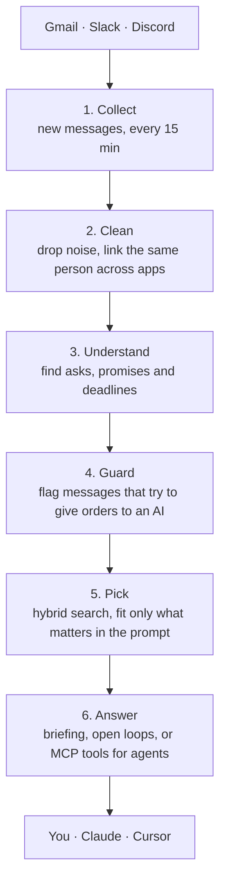

# ContextOS: A Context Layer for Your Messages

ContextOS turns scattered Gmail, Slack and Discord messages into clean, cited context for you and for AI agents. Its first job: **tell you who you owe a reply, and whose reply you're waiting on.** Everything runs on your computer, and every point links back to the message it came from.

[](https://www.python.org/)
[](https://fastapi.tiangolo.com/)
[](https://ai.google.dev/)
[](https://www.sqlite.org/)


## Why

Your inbox shows what's *new*, not what's *still pending*.

> Monday: a recruiter emails "please send your availability". You miss it.
> Thursday: ContextOS says *"Recruiter asked for your availability 3 days ago. No reply yet."*

## How It Works



Steps 1 to 4 are plain code (no model call). Gemini is used only to write the briefing, answer questions and embed text for search. Every citation it returns is checked against real messages, and every step is traced.

An open loop moves like this: **open** → (you answer) **closed**, or → ("I'll do it Friday") **promised** → **closed**, or → (no news for days) **stale**.

## What Gets Stored

Everything lives in one SQLite file, `~/.contextos/contextos.db`. One message, and what ContextOS builds from it:

```text
messages        rid=42  source=gmail  author="Priya Shah"  author_id="gmail:priya.shah@acme.com"
                text="Can you sign the Acme contract by Friday?"
                intent=request  due_hint=2026-11-06  risk=""            ← tagged by code at sync time

embeddings      rid=42  model=gemini-embedding-001  vec=<768 float32 values>   ← meaning search

identity_aliases  gmail "Priya Shah" ─┐
                  slack "Priya Shah" ─┼─ identity 7 "Priya Shah"
                  discord "priyashah" ┘

loops           L3  kind=you_owe  who="Priya Shah"  title="Sign the Acme contract"
                due=2026-11-06  status=open  refs=[m42]  threads=["gmail:t:gmail:abc"]

trace_spans     run 12 (briefing):  triage 2 ms · assemble 4 ms · llm.brief 3.1 s
                (tokens_in=8,412) · verify 1 ms · loops.apply 3 ms

audit_log       mcp  search_messages {"query": "contract"}  → 3 messages, 0 flagged
```

The model never sees raw history: open loops are carried day to day as one-line summaries like `[L3] you owe Priya Shah · open 2d (since Wed 04 Nov) · due 2026-11-06 · Sign the Acme contract: by Friday (from m42)`.

## Features

- **Open loops**: what you owe and what you're waiting on, across days and apps.
- **Daily briefing**: *Needs you*, *Important* and *FYI*, written each morning.
- **Ask**: "what did Priya say about the contract?", answered with links.
- **Hybrid search**: keywords (SQLite FTS5, bm25) plus meaning (Gemini embeddings, cosine), merged by Reciprocal Rank Fusion. Fixes typos in names and words, understands "last week".
- **One person, every app**: Gmail, Slack and Discord accounts of the same person are linked.
- **Injection guard**: messages that try to instruct an AI are marked untrusted and can never open or close a loop.
- **Traces page**: every briefing and question as a step waterfall, with the exact prompt, output, tokens and cost. Plus an audit log of every agent tool call.
- **MCP server**: Claude, Cursor or any agent can use all of it through read-only tools.

## Quick Start

```bash
git clone https://github.com/ShashwatXD/context-os.git && cd context-os
python3 -m venv .venv && source .venv/bin/activate
pip install -e ".[dev]"
echo 'GEMINI_API_KEY="your_key"' > .env     # from https://aistudio.google.com/apikey
contextos web                               # opens http://localhost:8000
```

Then connect sources on the **Sources** tab.

<details>
<summary><b>Gmail</b>: one-time setup, then "Sign in with Google"</summary>

1. In [Google Cloud Console](https://console.cloud.google.com), create a project and enable the **Gmail API**.
2. **OAuth consent screen** → External → add yourself under **Test users**.
3. **Credentials → Create credentials → OAuth client ID → Desktop app**.
4. Put the ID and secret in `.env` (or paste them on **Sources**):
   ```env
   GMAIL_CLIENT_ID="1234-abc.apps.googleusercontent.com"
   GMAIL_CLIENT_SECRET="your_client_secret"
   ```
5. Click **Sign in with Google**. Access is read-only, your account is remembered, and in test mode Google asks you to sign in again every 7 days (one-click **Reconnect**).
</details>

<details>
<summary><b>Slack</b>: user token, so your DMs are included</summary>

1. [api.slack.com/apps](https://api.slack.com/apps) → **Create New App → From scratch**.
2. **OAuth & Permissions → User Token Scopes**: `channels:history` `channels:read` `groups:history` `groups:read` `im:history` `im:read` `mpim:history` `mpim:read` `users:read`.
3. **Install to Workspace**, copy the `xoxp-` token into **Settings → Slack user token**.
</details>

<details>
<summary><b>Discord</b>: bot token, servers only</summary>

1. [Discord Developer Portal](https://discord.com/developers/applications) → new app → **Bot → Reset Token**, and turn on **Message Content Intent**.
2. **OAuth2 → URL Generator**: `bot` with **View Channels** and **Read Message History**; add it to your servers.
3. Paste the token into **Settings → Discord bot token**. Discord doesn't let apps read personal DMs.
</details>

## Use It From AI Agents (MCP)

```bash
claude mcp add contextos -- /path/to/context-os/.venv/bin/contextos mcp
```

For Claude Desktop or Cursor, add `{"mcpServers": {"contextos": {"command": "/path/to/context-os/.venv/bin/contextos", "args": ["mcp"]}}}` to their MCP config.

Tools: `open_loops`, `latest_briefing`, `search_messages`, `get_thread`, `who_is`, `recent_activity`. All are read-only, message text is marked untrusted, and every call lands in the audit log.

## Quality

```bash
contextos eval      # offline quality gate: no API key, under a second, runs in CI
contextos bench     # model-based benchmark on a 200-message labeled inbox (uses Gemini)
contextos trace     # recent runs in the terminal (the Traces tab shows the same)
contextos people    # who is linked across apps; `people merge` / `people split` to fix
```

| Layer (offline eval) | Score | Cases |
|---|---|---|
| Intent tagging | macro F1 1.00 | 72 messages, Hinglish included |
| Deadlines | accuracy 1.00 | 12 |
| Open-loop detection | precision 1.00, recall 0.83 | 14 conversations |
| Identity resolution | precision 1.00, recall 0.92 | 22 aliases |
| Injection guard | precision 0.92, recall 1.00 | 26 texts |

The sets are small and hand-written, so read them as a regression check, not a claim about real inboxes. Known misses are printed on every run. CI fails if any layer drops below its threshold.

For cost on the Traces page, add model prices (USD per million input/output tokens) to `.env`, for example `CONTEXTOS_PRICES="gemini-3.8-flash=0.30/2.50"`. Use current prices from Google's pricing page.

## Privacy

- All data, traces and logs stay in `~/.contextos`. Token files are readable only by you.
- The app only answers requests from your own machine.
- Message text is sent to the Gemini API only to write a briefing, answer a question or build the search index.

## Development

```bash
pytest          # all tests, including the quality gate (offline)
ruff check .    # lint
```
