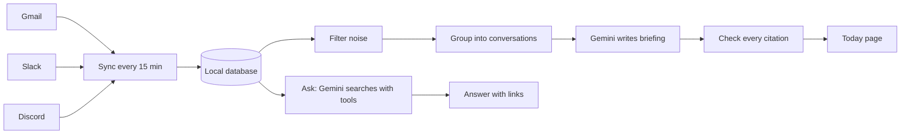

# ContextOS: Your Day, Summarized

ContextOS reads your Gmail, Slack and Discord and writes a short briefing of what happened today: what needs you, what's important, and what's just FYI. It runs on your own computer, and every point links back to the message it came from.

[](https://www.python.org/)
[](https://fastapi.tiangolo.com/)
[](https://ai.google.dev/)
[](https://www.sqlite.org/)

## Overview

Your messages are spread across too many places. ContextOS brings them into one local database, removes the noise, and asks **Gemini** to tell you what actually matters today.

It is built around one rule: **every claim must point to a real message.** The model has to cite its sources, ContextOS checks each citation, and anything it can't verify is clearly marked. You stay in control of what you trust.

## Core Features

| Feature | Description |
|---|---|
| **Daily Briefing** | A morning summary in three sections: *Needs you*, *Important* and *FYI*. |
| **Source Links** | Every item links to the original email or message, so you can check it in one click. |
| **Ask Anything** | Ask "what did Priya say about the contract?" and get an answer with links. |
| **Done and Snooze** | Mark items as handled or push them to tomorrow. A topic comes back if there's news. |
| **Noise Filter** | Promotions, muted channels and bot chatter are removed before the model sees them. |
| **Runs on Its Own** | Syncs every 15 minutes and writes a fresh briefing each morning. |
| **Feedback Loop** | Your 👍 / 👎 votes and "you missed this" notes are saved, so you can measure and improve quality. |
| **Private by Default** | Everything is stored on your machine. The app only answers to your own computer. |

## How It Works



1. **Sync**: new messages are fetched from each connected source and saved locally.
2. **Filter**: promotions and muted channels are skipped. Newsletters and bots are cut down to a one-line headline.
3. **Assemble**: messages are grouped by channel and thread, and each one gets a short tag like `m42`.
4. **Write**: Gemini turns this into a structured briefing. On very busy days, a lighter model summarizes in parts first.
5. **Verify**: every tag the model cites is checked against the real messages. Anything unsupported is flagged.
6. **Ask**: for questions, Gemini uses search tools over your messages, step by step, until it can answer.

## Tech Stack

- **Language**: Python 3.11+
- **Web**: FastAPI, Jinja templates, plain JavaScript (no build step)
- **AI**: Google Gemini (`gemini-3.8-flash` for briefings and questions, `gemini-3.1-flash-lite` for bulk summaries)
- **Storage**: SQLite with full-text search
- **Sources**: Gmail API, Slack Web API, Discord API

## Project Structure

```
context-os/
├── contextos/              # backend
│   ├── config.py            # settings from .env and the Settings tab
│   ├── models.py            # the Message shape every source maps into
│   ├── llm/                 # Gemini client: text, JSON output, tool calling
│   ├── sources/             # Gmail, Slack and Discord connectors
│   ├── storage/             # SQLite store and full-text search
│   ├── pipeline/            # noise filter, context assembly, briefing, ask
│   ├── services/            # sync, background jobs, scheduler
│   └── cli/                 # terminal commands
├── web/                     # website
│   ├── app.py               # FastAPI routes
│   ├── views.py             # turns stored data into what pages show
│   ├── templates/           # HTML pages
│   └── static/              # CSS and JavaScript
├── tests/
│   ├── unit/                # pipeline, sources, storage, Gemini wrapper
│   └── web/                 # pages, actions, jobs, security checks
└── pyproject.toml
```

## Getting Started

### Prerequisites

- Python 3.11 or newer
- A Gemini API key from [Google AI Studio](https://aistudio.google.com/apikey)
- At least one of: a Gmail account, a Slack workspace, a Discord server

### 1. Clone the Repository

```bash
git clone https://github.com/ShashwatXD/context-os.git
cd context-os
```

### 2. Install Dependencies

```bash
python3 -m venv .venv
source .venv/bin/activate
pip install -e ".[dev]"
```

### 3. Set Up Environment Variables

Create a file named `.env` in the project folder with your Gemini key:

```env
GEMINI_API_KEY="your_gemini_api_key_here"
```

The Gemini key is only ever read from `.env`. It is never entered or shown in the app.

### 4. Run the App

```bash
contextos web
```

Your browser opens [http://localhost:8000](http://localhost:8000).

## Connecting Sources

Open the **Sources** tab to connect accounts, and the **Settings** tab to paste tokens. Each source only needs to be set up once.

<details>
<summary><b>Gmail</b> (about 10 minutes)</summary>

1. Open [Google Cloud Console](https://console.cloud.google.com) and create a project.
2. Search for **Gmail API** and click **Enable**.
3. Open **OAuth consent screen**, choose **External**, and add yourself under **Test users**.
4. Go to **Credentials → Create credentials → OAuth client ID**, choose **Desktop app**, and download the JSON file.
5. In ContextOS, open **Sources**, upload the file, and click **Connect Gmail**.

Access is read-only. While the Google app is in test mode, you'll be asked to sign in again every 7 days.
</details>

<details>
<summary><b>Slack</b> (about 3 minutes)</summary>

1. Open [api.slack.com/apps](https://api.slack.com/apps) and choose **Create New App → From scratch**.
2. Under **OAuth & Permissions → User Token Scopes**, add:
   `channels:history` `channels:read` `groups:history` `groups:read` `im:history` `im:read` `mpim:history` `mpim:read` `users:read`
3. Click **Install to Workspace** and copy the token starting with `xoxp-`.
4. Paste it into **Settings → Slack user token**.
</details>

<details>
<summary><b>Discord</b> (about 3 minutes, servers only)</summary>

1. In the [Discord Developer Portal](https://discord.com/developers/applications), create an application, open **Bot**, and click **Reset Token**.
2. On the same page, turn on **Message Content Intent**.
3. Under **OAuth2 → URL Generator**, select `bot` with **View Channels** and **Read Message History**, then use the link to add the bot to your servers.
4. Paste the token into **Settings → Discord bot token**.

Discord does not allow apps to read personal DMs, so only servers are included.
</details>

## Usage

1. Open the **Today** tab and click **Write my briefing** (after the first day it's written for you each morning).
2. Click a source link on any item to jump to the original message.
3. Mark items **Done** or move them to **Tomorrow**.
4. Use **Ask** for anything the briefing doesn't cover.
5. Rate items with 👍 / 👎 to build up a record of what the briefing gets right.

## Development

```bash
pytest                  # run all tests (offline, no keys needed)
ruff check .            # check code style
ruff format .           # auto-format code
```

The same features are also available in the terminal: `contextos today`, `contextos ask "..."`, `contextos status`.

## Privacy

- All data lives in `~/.contextos` on your computer. Token files are readable only by you.
- The app only accepts requests from your own machine and blocks requests from other websites.
- To write a briefing, the text of that day's messages is sent to the Gemini API.

## Contributing

Issues and pull requests are welcome. Please run `pytest` and `ruff check .` before opening a pull request.
