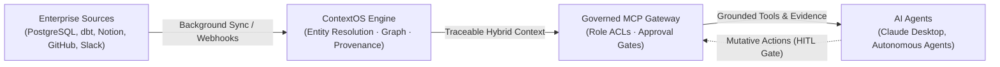

# ContextOS — Enterprise Context Infrastructure Platform for AI Agents

> **ContextOS** connects information from disparate enterprise systems (PostgreSQL data warehouses, Snowflake DDL, dbt transformation pipelines, Notion governance portals, GitHub repositories, and Slack discussions), discovers entities and relationships, builds a structured and cryptographically traceable context graph, enriches semantic metadata, and exposes trusted context to external AI agents through REST APIs and the **Model Context Protocol (MCP)**.

---

## 1. Repository Architecture

ContextOS is partitioned into two completely independent, decoupled repositories:

```
context-os/
│
├── contextos-api/           # Repository 1: Complete Backend, Context Engine & MCP Server
│   ├── app/
│   │   ├── domain/          # Pure Domain models (zero framework dependencies)
│   │   ├── application/     # Ingestion, Entity Resolution, Retrieval, Approvals, Eval
│   │   ├── infrastructure/  # SQLAlchemy 2.0, Connectors, Embeddings, LLM, MCP, Tracer
│   │   └── interfaces/      # FastAPI REST routes and CLI commands
│   ├── tests/               # 34 unit & integration tests (100% pass rate)
│   ├── demo/                # Synthetic enterprise dataset (Acme Analytics)
│   ├── Dockerfile           # Python 3.12 multi-stage build container
│   ├── docker-compose.yml   # PostgreSQL 16 + pgvector environment
│   └── README.md            # Exhaustive 20-section architecture & setup guide
│
└── contextos-web/           # Repository 2: Frontend Engineering Console
    ├── src/
    │   ├── app/             # Next.js 14 App Router (10 primary navigation views)
    │   ├── components/      # Atlan-inspired minimalist design system
    │   └── lib/             # Typed API client & domain models
    ├── package.json         # React 18, Next 14, Lucide React, Tailwind CSS
    └── README.md            # 20-section UI architecture & screen documentation
```

---

## 2. High-Level System Architecture



---

## 3. Core Engineering Capabilities

1. **Three Data Access Mechanisms**:
   - **Mechanism A (Background Synchronization)**: Incremental sync using cursors, checkpoints, idempotency keys, and exponential backoff retry with automatic quarantining to a **Dead-Letter Queue (DLQ)**.
   - **Mechanism B (On-Demand Context Retrieval)**: The primary agent query path via standard Model Context Protocol (MCP) tools and REST APIs.
   - **Mechanism C (Live Source Fallback)**: Automatically triggers a live provider API fetch when local context exceeds the freshness SLA threshold ($900\text{s}$) or is missing from the local index.
2. **Official Enterprise Connectors**:
   - **PostgreSQL**: Table DDL, column schemas, and primary key extraction.
   - **dbt**: Parses `manifest.json` for model transformations, descriptions, and upstream lineage.
   - **Notion**: Ingests KPI definitions, metrics, and business policies.
   - **GitHub**: Pull requests, commits, and AST Python function/class symbol parsing.
   - **Slack**: Channel discussions with content-aware thread chunking and permalinks.
3. **Multi-Stage Entity Resolution**: Normalizes prefixes, matches canonical names, computes token set containment and Levenshtein edit distance, auto-linking matches with confidence $\ge 0.85$ while routing borderline matches ($0.70 - 0.84$) to the Human Review Queue.
4. **4-Way Storage Segregation**: Separates raw provider events, the graph knowledge layer, dense vector embeddings with role-based ACLs, and agent telemetry.
5. **Traceable Hybrid Retrieval**: Combines full-text search with dense vector similarity, fused via **Reciprocal Rank Fusion (RRF)** ($k=60$) and traversed via multi-hop BFS graph lineage.
6. **Governed Agent Runtime & MCP Protocol**: Exposes 7 semantic MCP tools with permission policies and human-in-the-loop approval barriers (`PENDING_REVIEW` $\to$ `APPROVED`).
7. **Empirical Evaluation Benchmark**: Reproducible golden benchmark measuring Recall@K ($0.900$), entity resolution accuracy ($0.950$), context relevance ($0.880$), and policy compliance ($100\%$).

---

## 4. Quickstart & Local Execution

### 1. Backend (`contextos-api`)

```bash
cd contextos-api

# Create and activate virtual environment
python3 -m venv .venv
source .venv/bin/activate

# Install dependencies
pip install -r requirements.txt greenlet aiosqlite

# Run the automated test suite (34 passing tests)
pytest tests -v

# Seed the Acme Analytics synthetic enterprise dataset
python -m app.cli demo seed

# Execute the end-to-end Revenue Discrepancy scenario
python -m app.cli demo run

# Start the FastAPI REST and MCP server
uvicorn app.main:app --host 0.0.0.0 --port 8000 --reload
```
API Documentation: `http://localhost:8000/docs`

### 2. Frontend (`contextos-web`)

```bash
cd contextos-web

# Install dependencies
npm install

# Build static production bundle (verifies type safety)
npm run build

# Start the Next.js development server
npm run dev
```
Console UI: `http://localhost:3000`

---

## 5. Primary End-to-End Demonstration Scenario

The system models **Acme Analytics**, a high-growth SaaS business investigating an executive metric discrepancy:

> *"Why does our monthly revenue dashboard show a different number from the finance report?"*

```bash
$ python -m app.cli demo run
```

1. **Grounded Entity Discovery**: Locates the certified Finance policy (`Monthly Recurring Revenue (MRR)`), the engineering fix in GitHub (`PR #142`), and the contradictory Sales commission document (`Monthly Billed Revenue`).
2. **Multi-Hop Lineage Traversal**: Traces the dependency flow from raw `stripe_charges` through dbt transformation models to downstream BI dashboards.
3. **Definition Conflict Detection**: Detects that Sales Operations evaluates gross billed invoices, whereas certified Finance policy strictly deducts chargebacks and refund churn (`DISPUTED_DEFINITION` detected with $0.91$ confidence).
4. **Governed Agent Action**: Agent proposes metric redefinition (`request_metric_correction`). ContextOS intercepts the action and places the execution into `WAITING_APPROVAL`.
5. **Human Approval Decision**: Human steward reviews the evidence and approves the certification in the Web Console (`/governance`).

---

## 6. Detailed Repository Documentation

For in-depth architectural specifications, entity relationship diagrams, and implementation details:
- **[Backend Architecture & Guide (`contextos-api/README.md`)](file:///Users/shashwat/Desktop/context-os/contextos-api/README.md)** (20 sections, 9 Mermaid diagrams)
- **[Frontend Architecture & Screens (`contextos-web/README.md`)](file:///Users/shashwat/Desktop/context-os/contextos-web/README.md)** (20 sections, 10 screen guides)
