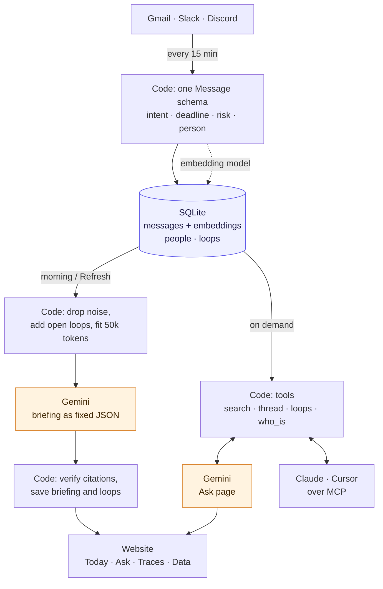
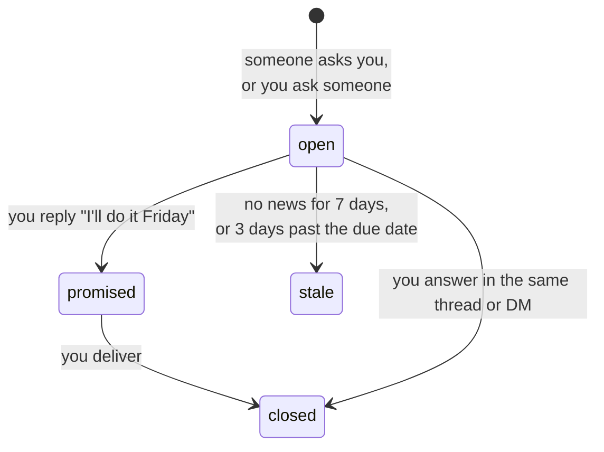

# ContextOS: A Context Layer for Your Messages

ContextOS turns scattered Gmail, Slack and Discord messages into clean, cited context for you and for AI agents. Its first job: **tell you who you owe a reply, and whose reply you're waiting on.** Everything runs on your computer, and every point links back to the message it came from.

[](https://www.python.org/)
[](https://fastapi.tiangolo.com/)
[](https://ai.google.dev/)
[](https://www.sqlite.org/)


## Why

Your inbox shows what's *new*, not what's *still pending*.

> Monday: a recruiter emails "please send your availability". You miss it.
> Thursday: ContextOS says *"Recruiter asked for your availability 3 days ago. No reply yet."*

## How It Works

Every message, from any source, is converted into **one schema**, linked to **the person** who sent it, and stored with its **embedding**. The LLM only ever reads that schema, and answers in **a fixed JSON schema**. The same stored data is served to the website and, over MCP, to other AI agents.



Orange boxes call an LLM. Everything else is plain code.

### Where AI is used

| Call | When | Model | Output |
|---|---|---|---|
| Embedding | After each sync, and for each search query | `gemini-embedding-001` | 768 numbers per message, stored next to it |
| Briefing | Each morning, or on Refresh | `gemini-3.8-flash` | JSON: needs you, important, FYI, loops opened/updated |
| Condense | Only on days over 50k tokens: chunks of 25k, 4 in parallel | `gemini-3.1-flash-lite` | Short notes that keep every `[m42]` citation |
| Ask | Each question, up to 8 tool-calling turns | `gemini-3.8-flash` | Answer with `[m42]` citations |

Fetching, converting to the schema, intent and deadline tags, linking people, the injection guard, the noise filter, search scoring, citation checks and closing loops are all code. All model calls go through one file, `contextos/llm/gemini.py`, with retries on rate limits and a recorded token count for each call.

### Open loops



A loop is opened by the briefing, only with evidence from a real message the guard didn't flag. It is closed by code when your reply lands in the same thread or DM, with no model call. Each day the model sees open loops as one line each, not the old messages.

## What Gets Stored

Everything lives in one SQLite file, `~/.contextos/contextos.db`. One message, and what ContextOS builds from it:

```text
messages        rid=42  source=gmail  author="Priya Shah"  author_id="gmail:priya.shah@acme.com"
                text="Can you sign the Acme contract by Friday?"
                intent=request  due_hint=2026-11-06  risk=""            ← tagged by code at sync time

embeddings      rid=42  model=gemini-embedding-001  vec=<768 float32 values>   ← meaning search

identity_aliases  gmail "Priya Shah" ─┐
                  slack "Priya Shah" ─┼─ identity 7 "Priya Shah"
                  discord "priyashah" ┘

loops           L3  kind=you_owe  who="Priya Shah"  title="Sign the Acme contract"
                due=2026-11-06  status=open  refs=[m42]  threads=["gmail:t:gmail:abc"]

trace_spans     run 12 (briefing):  triage 2 ms · assemble 4 ms · llm.brief 3.1 s
                (tokens_in=8,412) · verify 1 ms · loops.apply 3 ms

audit_log       mcp  search_messages {"query": "contract"}  → 3 messages, 0 flagged
```

The model never sees raw history: open loops are carried day to day as one-line summaries like `[L3] you owe Priya Shah · open 2d (since Wed 04 Nov) · due 2026-11-06 · Sign the Acme contract: by Friday (from m42)`.

## Features

- **Open loops**: what you owe and what you're waiting on, across days and apps.
- **Daily briefing**: *Needs you*, *Important* and *FYI*, written each morning.
- **Ask**: "what did Priya say about the contract?", answered with links.
- **Hybrid search**: keywords (SQLite FTS5, bm25) plus meaning (Gemini embeddings, cosine), merged by Reciprocal Rank Fusion. Fixes typos in names and words, understands "last week".
- **One person, every app**: Gmail, Slack and Discord accounts of the same person are linked.
- **Injection guard**: messages that try to instruct an AI are marked untrusted and can never open or close a loop.
- **Traces page**: every briefing and question as a step waterfall, with the exact prompt, output, tokens and cost. Plus an audit log of every agent tool call.
- **MCP server**: Claude, Cursor or any agent can use all of it through read-only tools.

## Quick Start

```bash
git clone https://github.com/ShashwatXD/context-os.git && cd context-os
python3 -m venv .venv && source .venv/bin/activate
pip install -e ".[dev]"
echo 'GEMINI_API_KEY="your_key"' > .env     # from https://aistudio.google.com/apikey
contextos web                               # opens http://localhost:8000
```

Then connect sources on the **Sources** tab.

<details>
<summary><b>Gmail</b>: one-time setup, then "Sign in with Google"</summary>

1. In [Google Cloud Console](https://console.cloud.google.com), create a project and enable the **Gmail API**.
2. **OAuth consent screen** → External → add yourself under **Test users**.
3. **Credentials → Create credentials → OAuth client ID → Desktop app**.
4. Put the ID and secret in `.env` (or paste them on **Sources**):
   ```env
   GMAIL_CLIENT_ID="1234-abc.apps.googleusercontent.com"
   GMAIL_CLIENT_SECRET="your_client_secret"
   ```
5. Click **Sign in with Google**. Access is read-only, your account is remembered, and in test mode Google asks you to sign in again every 7 days (one-click **Reconnect**).
</details>

<details>
<summary><b>Slack</b>: user token, so your DMs are included</summary>

1. [api.slack.com/apps](https://api.slack.com/apps) → **Create New App → From scratch**.
2. **OAuth & Permissions → User Token Scopes**: `channels:history` `channels:read` `groups:history` `groups:read` `im:history` `im:read` `mpim:history` `mpim:read` `users:read`.
3. **Install to Workspace**, copy the `xoxp-` token into **Settings → Slack user token**.
</details>

<details>
<summary><b>Discord</b>: bot token, servers only</summary>

1. [Discord Developer Portal](https://discord.com/developers/applications) → new app → **Bot → Reset Token**, and turn on **Message Content Intent**.
2. **OAuth2 → URL Generator**: `bot` with **View Channels** and **Read Message History**; add it to your servers.
3. Paste the token into **Settings → Discord bot token**. Discord doesn't let apps read personal DMs.
</details>

## Use It From AI Agents (MCP)

ContextOS runs as a local MCP server over stdio: your AI app starts `contextos mcp` as a background process and talks to it through stdin/stdout. Nothing listens on a port, and the data never leaves your machine.

```bash
claude mcp add contextos -- /path/to/context-os/.venv/bin/contextos mcp
```

For Claude Desktop or Cursor, add `{"mcpServers": {"contextos": {"command": "/path/to/context-os/.venv/bin/contextos", "args": ["mcp"]}}}` to their MCP config.

| Tool | Input | Returns |
|---|---|---|
| `open_loops` | none | What you owe people and what you're waiting on, with links |
| `latest_briefing` | `window`: `today` or `24h` | Today's briefing |
| `search_messages` | `query`, `person`, `after`, `before`, `source`, `channel` (all optional) | Matching messages from every app |
| `get_thread` | `ref`, e.g. `m42` | The whole conversation |
| `who_is` | `person` | One person's names and accounts across apps |
| `recent_activity` | `days` | Active inboxes and channels, with counts |

What happens when you ask Claude "what do I still owe people?":

1. On start, Claude's app launches `contextos mcp` and receives the six tools and their input schemas.
2. Claude's model decides to call `open_loops`.
3. ContextOS reads SQLite (no LLM), writes the call to the audit log, and returns the loops with links, marked as untrusted data.
4. Claude's model writes the answer.

The thinking is done by the calling agent's model. ContextOS only uses Gemini here to embed the query for `search_messages`. All tools are read-only.

## Quality

```bash
contextos eval      # offline quality gate: no API key, under a second, runs in CI
contextos bench     # model-based benchmark on a 200-message labeled inbox (uses Gemini)
contextos trace     # recent runs in the terminal (the Traces tab shows the same)
contextos people    # who is linked across apps; `people merge` / `people split` to fix
```

| Layer (offline eval) | Score | Cases |
|---|---|---|
| Intent tagging | macro F1 1.00 | 72 messages, Hinglish included |
| Deadlines | accuracy 1.00 | 12 |
| Open-loop detection | precision 1.00, recall 0.83 | 14 conversations |
| Identity resolution | precision 1.00, recall 0.92 | 22 aliases |
| Injection guard | precision 0.92, recall 1.00 | 26 texts |

The sets are small and hand-written, so read them as a regression check, not a claim about real inboxes. Known misses are printed on every run. CI fails if any layer drops below its threshold.

For cost on the Traces page, add model prices (USD per million input/output tokens) to `.env`, for example `CONTEXTOS_PRICES="gemini-3.8-flash=0.30/2.50"`. Use current prices from Google's pricing page.

## Known Limitations

- The briefing window starts at midnight, so a message (or your reply) that arrives after your last Refresh of the day isn't seen by the next morning's briefing. A fix that starts each window where the last briefing ended is planned.
- A reply sent after a loop went stale doesn't close it.
- Intent and deadlines come from rules: an ask worded in an unusual way is tagged `info`. The model still sees the full message in the briefing.
- Promotions are stored and embedded so they stay searchable; they are only dropped when the briefing is built.

## Privacy

- All data, traces and logs stay in `~/.contextos`. Token files are readable only by you.
- The app only answers requests from your own machine.
- Message text is sent to the Gemini API only to write a briefing, answer a question or build the search index.

## Development

```bash
pytest          # all tests, including the quality gate (offline)
ruff check .    # lint
```
