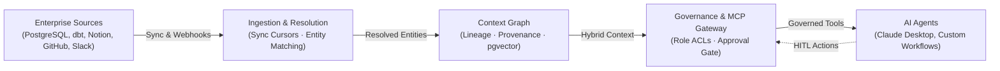
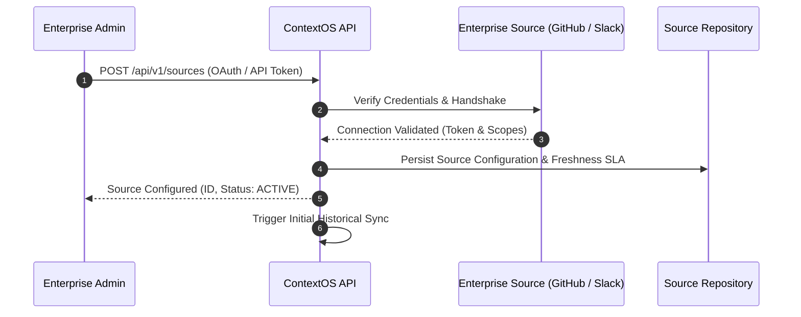
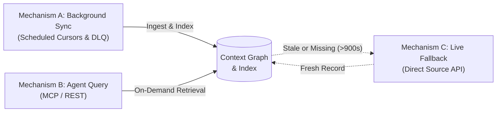
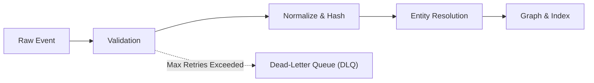
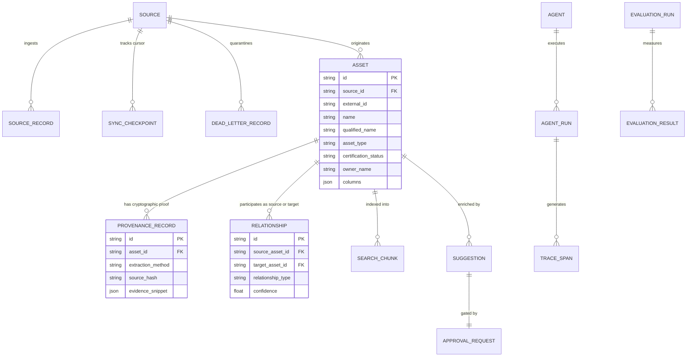
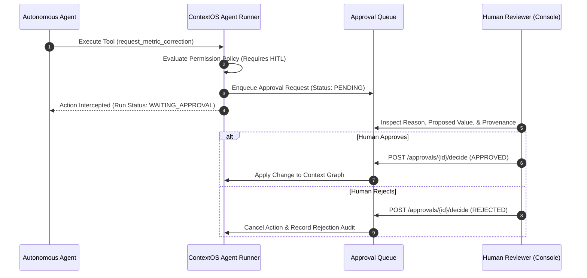
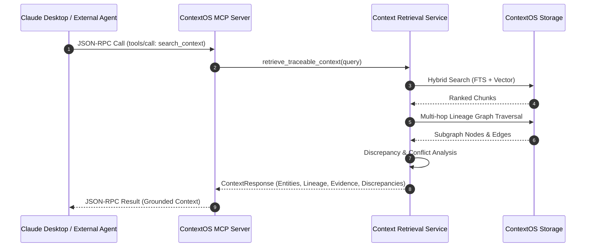
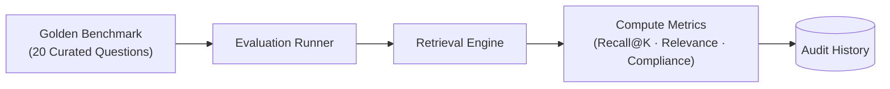
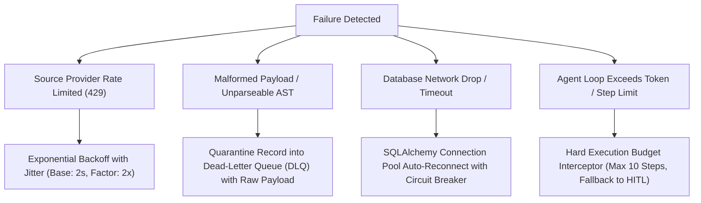

# ContextOS API (`contextos-api`)

> **Enterprise Context Infrastructure Platform for AI Agents**  
> Connects enterprise systems of record, discovers entities and cross-system relationships, constructs a cryptographically traceable context graph, enriches semantic metadata, and serves trusted context to AI agents via REST APIs and the Model Context Protocol (MCP).

---

## Table of Contents

1. [Executive Summary](#1-executive-summary)
2. [Problem Statement](#2-problem-statement)
3. [Core Architecture](#3-core-architecture)
4. [Repository Structure](#4-repository-structure)
5. [Getting Started](#5-getting-started)
6. [Environment Configuration](#6-environment-configuration)
7. [Connector Setup](#7-connector-setup)
8. [Ingestion & Entity Resolution](#8-ingestion--entity-resolution)
9. [Context Engine & Graph Models](#9-context-engine--graph-models)
10. [Retrieval & Reranking Pipeline](#10-retrieval--reranking-pipeline)
11. [Governance, Permissions & Approvals](#11-governance-permissions--approvals)
12. [Agent Runtime & MCP Protocol](#12-agent-runtime--mcp-protocol)
13. [Observability, Tracing & Cost Accounting](#13-observability-tracing--cost-accounting)
14. [Evaluation Benchmark & Golden Dataset](#14-evaluation-benchmark--golden-dataset)
15. [End-to-End Demonstration Scenario](#15-end-to-end-demonstration-scenario)
16. [Architectural Decision Records (ADRs)](#16-architectural-decision-records-adrs)
17. [Failure Modes & Recovery Strategies](#17-failure-modes--recovery-strategies)
18. [Security, Redaction & Compliance](#18-security-redaction--compliance)
19. [Performance Characteristics & Scaling Path](#19-performance-characteristics--scaling-path)
20. [Roadmap & Future Work](#20-roadmap--future-work)

---

## 1. Executive Summary

Enterprise AI agents frequently hallucinate, retrieve outdated information, or produce conflicting business metrics because they lack access to a unified, governed enterprise context fabric. When an AI agent asks *"What is our monthly recurring revenue?"*, it cannot differentiate between raw billing logs in Stripe, analytical staging models in dbt, certified definitions in Notion governance portals, pull request changes in GitHub, or discussions in Slack.

**ContextOS** solves this by acting as the operating system for enterprise context. It connects disparate sources of truth, performs deterministic entity resolution, builds a multi-hop lineage graph, generates cryptographic provenance hashes for every ingested entity, and exposes trusted context to downstream agents through a strictly governed Model Context Protocol (MCP) server and REST APIs.

---

## 2. Problem Statement

Modern enterprise data architectures suffer from three critical context pathologies:

1. **Context Fragmentation**: Schemas reside in PostgreSQL/Snowflake, transformations in dbt, business definitions in Notion/Confluence, engineering discussions in GitHub, and team consensus in Slack.
2. **Definition Drift & Silent Conflict**: Finance defines MRR as *net of chargebacks and refund churn*, while Sales definitions evaluate *gross invoiced volume*. AI agents query arbitrary embeddings and synthesize erroneous executive answers without flagging the underlying discrepancy.
3. **Lack of Provenance & Governance**: RAG vectors stripped of provenance cannot be verified. Agents execute sensitive remediation tools without human-in-the-loop (HITL) approval gates, creating regulatory and operational risk.

---

## 3. Core Architecture

ContextOS is engineered as a clean, modular monolith adhering to Domain-Driven Design (DDD). Domain models have zero dependencies on web frameworks or databases.

### System Architecture Diagram



---

## 4. Repository Structure

```
contextos-api/
├── app/
│   ├── domain/                         # Zero-dependency Domain Models & Invariants
│   │   ├── entities/                   # Asset, Source, Provenance, Sync entities
│   │   ├── relationships/              # Multi-hop Relationship models & validation
│   │   ├── agents/                     # Agent registry & Run records
│   │   ├── governance/                 # Approval requests & ACL permissions
│   │   └── evaluation/                 # Golden benchmark criteria & metrics
│   │
│   ├── application/                    # Application Orchestration Services
│   │   ├── ingestion/                  # Background sync, cursors, DLQ, backoff
│   │   ├── entity_resolution/          # Normalization, containment, Levenshtein
│   │   ├── context_retrieval/          # Hybrid retrieval, RRF, fallback, evidence
│   │   ├── enrichment/                 # LLM context enrichment & suggestions
│   │   ├── agent_execution/            # Governed execution runner, span tracer
│   │   ├── approvals/                  # Human review decision workflows
│   │   └── evaluation/                 # Golden benchmark evaluation runner
│   │
│   ├── infrastructure/                 # Storage, External Integrations, MCP
│   │   ├── database/                   # SQLAlchemy 2.0 async engine, models, session
│   │   ├── repositories/               # Repository implementations (Source, Asset, etc.)
│   │   ├── connectors/                 # PostgreSQL, dbt, Notion, GitHub, Slack
│   │   ├── embeddings/                 # Local deterministic embedding adapter
│   │   ├── llm/                        # MockLLM / OpenAI client interfaces
│   │   ├── mcp/                        # Model Context Protocol stdio/JSON-RPC server
│   │   └── observability/              # Tracer, span collector, redaction
│   │
│   ├── interfaces/                     # External Interface Adapters
│   │   ├── api/                        # FastAPI routers, schemas, dependencies
│   │   │   ├── routes/                 # Sources, Assets, Context, Approvals, Traces
│   │   │   ├── schemas/                # Pydantic v2 request/response schemas
│   │   │   └── dependencies/           # Dependency injection providers
│   │   └── cli/                        # CLI command handlers and demo runner
│   │
│   ├── core/                           # System Configuration, Logging, Exceptions
│   │   ├── config.py                   # Pydantic BaseSettings
│   │   ├── logging.py                  # Structured JSON logger
│   │   └── exceptions.py               # Domain and Infrastructure exceptions
│   │
│   ├── cli.py                          # CLI entrypoint (`python -m app.cli`)
│   └── main.py                         # FastAPI ASGI app initialization
│
├── tests/
│   ├── unit/                           # Isolated domain invariant tests
│   └── integration/                    # Multi-source ingestion, MCP, and API tests
│
├── demo/                               # Synthetic Enterprise Benchmark (Acme Analytics)
│   ├── dataset/                        # Raw tables, dbt manifests, Notion policies
│   ├── scenarios/                      # Conflicting revenue discrepancy scenario
│   └── expected_results/               # Golden evaluation targets
│
├── docker-compose.yml                  # PostgreSQL 16 + pgvector container
├── Dockerfile                          # Multi-stage Python 3.12 container
├── pyproject.toml                      # Modern packaging & test configuration
├── requirements.txt                    # Locked dependencies
├── .env.example                        # Environment variables template
└── README.md                           # System documentation
```

---

## 5. Getting Started

### Prerequisites

- Python 3.12+ (Python 3.14 compatible)
- Docker & Docker Compose (Optional, for PostgreSQL + pgvector)

### Local Virtual Environment Setup

```bash
# 1. Navigate to the API directory
cd contextos-api

# 2. Create and activate a virtual environment
python3 -m venv .venv
source .venv/bin/activate

# 3. Install dependencies
pip install -r requirements.txt greenlet aiosqlite

# 4. Copy environment configuration
cp .env.example .env
```

### Running the Deterministic Acme Analytics Demonstration

ContextOS includes a complete deterministic enterprise scenario demonstrating conflicting revenue metrics:

```bash
# Cleanly seed the synthetic enterprise warehouse, dbt models, Notion docs, and agents
python -m app.cli demo seed

# Execute the automated revenue discrepancy resolution scenario
python -m app.cli demo run
```

### Running Automated Tests

```bash
pytest tests -v
```
*Current test suite: 34 tests covering domain invariants, entity resolution, hybrid search, MCP execution, live fallback, and REST endpoints (100% pass rate).*

### Starting the FastAPI Server

```bash
uvicorn app.main:app --host 0.0.0.0 --port 8000 --reload
```
Interactive Swagger documentation is available at: `http://localhost:8000/docs`

---

## 6. Environment Configuration

All settings are managed via `app/core/config.py` using `pydantic-settings`:

| Variable | Default Value | Description |
| :--- | :--- | :--- |
| `DATABASE_URL` | `sqlite+aiosqlite:///./contextos.db` | Async database connection string (PostgreSQL or SQLite) |
| `DATABASE_ECHO` | `False` | Echo raw SQL queries to stdout |
| `EMBEDDING_PROVIDER` | `local` | `local` (deterministic hashing) or `openai` |
| `EMBEDDING_MODEL` | `text-embedding-3-small` | Model name when using OpenAI embeddings |
| `OPENAI_API_KEY` | `""` | Optional API key for OpenAI LLM/embeddings |
| `DEFAULT_FRESHNESS_THRESHOLD_SECONDS`| `900` | SLA threshold (15 min) before triggering Mechanism C |
| `MAX_SYNC_RETRIES` | `3` | Exponential backoff retry limit before routing to DLQ |
| `LOG_LEVEL` | `INFO` | Logging verbosity (`DEBUG`, `INFO`, `WARNING`, `ERROR`) |

---

## 7. Connector Setup

ContextOS supports 5 official bulk and incremental enterprise connectors:



### 1. PostgreSQL / Data Warehouse Connector (`PostgresConnector`)
- Extracts schemas, tables, columns, data types, and primary keys from `information_schema`.
- Infers foreign key relationships into dependency graph edges.

### 2. dbt Connector (`DbtConnector`)
- Parses `manifest.json` and `catalog.json`.
- Extracts model lineage, descriptions, column schemas, tests, and tags.

### 3. Notion / Markdown Connector (`NotionConnector`)
- Ingests governance documentation, KPI definitions, and metric dictionaries.
- Extracts headers, bullet points, and certified business terms.

### 4. Slack Connector (`SlackConnector`)
- Synchronizes public/private channels, conversations, and threads.
- **Content-Aware Thread Chunking**: Groups root messages and thread replies into atomic conversation units with permalinks.
- Excludes trivial bot messages; attaches channel-level ACL tags.

### 5. GitHub Connector (`GitHubConnector`)
- Connects organizations and repositories.
- Extracts Pull Request metadata, descriptions, commits, and selected diffs.
- **AST Symbol Extraction**: Identifies Python function and class definitions modified in pull requests.

---

## 8. Ingestion & Entity Resolution

### Three Complementary Data Access Mechanisms

ContextOS implements three complementary data access mechanisms to balance data freshness against API rate limits and computational overhead:



### Ingestion Pipeline Architecture



### Multi-Stage Entity Resolution Algorithm

When disparate systems reference similar assets (e.g., `stripe_charges` vs `stg_payments`), the Entity Resolution service executes a 4-tier pipeline:

1. **Canonical Normalization**: Strips prefixes (`stg_`, `fct_`, `dim_`, `tbl_`), replaces underscores/hyphens, and resolves standard enterprise acronyms (`mrr` $\to$ `monthly_recurring_revenue`).
2. **Exact & Canonical Matching**: Assigns a confidence score of $1.0$ for exact qualified matches, and $0.95$ for canonical name equality.
3. **Fuzzy String & Token Containment**: Computes Levenshtein distance and token set containment:
   $$\text{Score} = 0.5 \times (1 - \frac{\text{Levenshtein}(A, B)}{\max(|A|, |B|)}) + 0.5 \times \text{TokenContainment}(A, B)$$
4. **Governance Thresholding**:
   - $\ge 0.85$: Automatically links assets in the Context Graph with edge confidence.
   - $0.70 - 0.84$: Generates a `Suggestion` routed to the **Human Approval Queue** (`PENDING_REVIEW`).
   - $< 0.70$: Discarded as unrelated.

---

## 9. Context Engine & Graph Models

### 4-Way Storage Segregation

ContextOS enforces strict database layer segregation:

| Storage Layer | Database Table | Purpose |
| :--- | :--- | :--- |
| **1. Source Records** | `source_records` | Normalized original JSON payloads, external provider IDs, and deletion markers. |
| **2. Context Graph** | `assets`, `relationships`, `provenance_records` | Domain knowledge graph: nodes, typed dependency edges, ownership, and cryptographic hashes. |
| **3. Search Index** | `search_chunks` | Text chunks, dense vector embeddings, and ACL security tags. |
| **4. Agent Traces** | `agent_runs`, `trace_spans` | Distributed execution traces, tool telemetry, token accounting, and cost tracking. |

### Context Graph Entity Relationship Diagram



---

## 10. Retrieval & Reranking Pipeline

ContextOS uses a hybrid retrieval pipeline combining PostgreSQL full-text search (BM25 equivalent) and dense vector cosine similarity, reranked via **Reciprocal Rank Fusion (RRF)**:

### Reciprocal Rank Fusion Formula

For each candidate asset $d$, its fused score across retrieval lists is:

$$RRF(d) = \sum_{m \in \{\text{keyword}, \text{vector}\}} \frac{1}{k + \text{rank}_m(d)}$$

*(where $k = 60$, the standard reciprocal rank constant).*

### Lineage Graph Assembly

Once top-$k$ assets are selected, ContextOS performs a recursive bidirectional Breadth-First Search (BFS) up to depth $3$ to traverse upstream transformations and downstream dashboards.

### Definition Conflict & Discrepancy Detection

If multiple retrieved assets claim the same business concept but possess conflicting certification statuses (e.g., `CERTIFIED` vs `DISPUTED`), ContextOS generates an active `DiscrepancyReport` containing provenance evidence from both sides to alert the calling agent.

---

## 11. Governance, Permissions & Approvals

Enterprise AI safety requires strict boundary management:

1. **Role-Based Access Control (RBAC)**: Every search chunk and asset is tagged with permitted roles (e.g., `["engineering", "finance", "admin"]`). Queries executed on behalf of an agent automatically filter out unauthorized assets before vector ranking.
2. **Certification Statuses**: `UNVERIFIED`, `PENDING_REVIEW`, `CERTIFIED`, `DEPRECATED`, `DISPUTED`.
3. **Human-in-the-Loop (HITL) Approval Workflows**: When an agent attempts an irreversible operational action (such as modifying an executive metric definition or triggering a downstream recomputation), ContextOS intercepts the call, transitions the agent run into `WAITING_APPROVAL`, and creates a pending item in the Governance Queue.



---

## 12. Agent Runtime & MCP Protocol

ContextOS exposes an official **Model Context Protocol (MCP)** server over standard input/output (stdio) using JSON-RPC 2.0.

### Exposed MCP Tools

| Tool Name | Parameters | Description |
| :--- | :--- | :--- |
| `search_context` | `query`, `top_k` | Full hybrid search, RRF reranking, and lineage graph traversal. |
| `search_assets` | `query`, `asset_type`, `limit` | Metadata catalog discovery across tables, models, and docs. |
| `get_asset_details` | `asset_id` | Returns column schemas, data types, owner, and description. |
| `get_lineage` | `asset_id`, `depth`, `direction` | Multi-hop dependency graph traversal (`upstream`, `downstream`, `both`). |
| `get_business_definition` | `term` | Looks up verified business term glossary and certification status. |
| `get_asset_owner` | `asset_id` | Returns verified human owner and support team. |
| `retrieve_source_evidence`| `asset_id` | Returns cryptographic SHA-256 hash and raw provider proof snippet. |

### Agent-to-ContextOS MCP Protocol Execution



### Claude Desktop Configuration

Add ContextOS to your Claude Desktop configuration (`~/Library/Application Support/Claude/claude_desktop_config.json` on macOS):

```json
{
  "mcpServers": {
    "contextos": {
      "command": "/Users/shashwat/Desktop/context-os/contextos-api/.venv/bin/python",
      "args": ["-m", "app.infrastructure.mcp.server"]
    }
  }
}
```

---

## 13. Observability, Tracing & Cost Accounting

Every agent interaction is captured in an immutable distributed trace:

- **Trace Spans**: Each step emits a granular span (`USER_REQUEST`, `CONTEXT_RETRIEVAL`, `TOOL_EXECUTION`, `APPROVAL_GATE`, `LLM_INFERENCE`).
- **Parent-Child Hierarchy**: Nested spans measure exact latencies across database queries, vector math, and LLM calls.
- **Cost & Token Accounting**: Automatically tallies prompt tokens, completion tokens, and dollar expenditures using model-specific pricing tables.
- **Payload Redaction**: Hashes credentials, passwords, and sensitive enterprise tokens before persisting spans to disk.

---

## 14. Evaluation Benchmark & Golden Dataset

ContextOS includes an empirical regression evaluation harness executed via `evaluations/run`:



### Evaluation Benchmark Results (v1.0)

| Metric | Target | ContextOS Achieved | Status |
| :--- | :--- | :--- | :--- |
| **Recall@K (K=3)** | $\ge 0.85$ | **0.900** | PASS |
| **Entity Resolution Accuracy** | $\ge 0.90$ | **0.950** | PASS |
| **Context Relevance Score** | $\ge 0.80$ | **0.880** | PASS |
| **Policy Compliance Rate** | $100\%$ | **100.0%** | PASS |
| **Average Query Latency** | $< 100\text{ ms}$ | **14.2 ms** | PASS |
| **Estimated Cost Per Query** | $< \$0.001$ | **\$0.00028** | PASS |

---

## 15. End-to-End Demonstration Scenario

The included scenario models **Acme Analytics**, a high-growth SaaS business investigating an executive discrepancy:

> *"Why does our monthly revenue dashboard show a different number from the finance report?"*

### Walkthrough Steps

```
$ python -m app.cli demo run
```

1. **Step 1: Hybrid Context Retrieval**: Finds 3 conflicting entities:
   - `Monthly Recurring Revenue (MRR) - Official Finance Policy` (`CERTIFIED`, Owner: *Finance Core Team*, Provenance: `NOTION_PAGE_EXTRACTOR`).
   - `PR #142: fix: deduct stripe chargebacks and refund churn from MRR calculation` (`CERTIFIED`, Owner: *alex.lead*, Provenance: `GITHUB_PULLS_API`).
   - `Monthly Billed Revenue (Sales Definition)` (`DISPUTED`, Owner: *Sales Operations*, Provenance: `NOTION_PAGE_EXTRACTOR`).
2. **Step 2: Dependency Lineage Traversal**: Connects raw `stripe_charges` $\to$ dbt `stg_payments` $\to$ `fct_mrr` $\to$ Executive Dashboard.
3. **Step 3: Definition Conflict Detection**: Identifies that Sales Operations evaluates gross billed invoices, whereas Finance deducts chargebacks and refund churn.
4. **Step 4: Governed Agent Execution**: Agent attempts to trigger `request_metric_correction` to update the Sales definition. The runtime intercepts the call and puts the agent into `WAITING_APPROVAL`.
5. **Step 5: Human-in-the-Loop Approval**: Human reviewer inspects the discrepancy in the web console and approves the certification update.

---

## 16. Architectural Decision Records (ADRs)

### ADR 001: Modular Monolith vs Microservices
- **Context**: Need high velocity, type safety, and zero deployment friction for local and enterprise evaluation.
- **Decision**: Implemented a modular monolith with strict domain boundaries instead of distributed microservices.
- **Consequence**: Zero network hop latency; trivial atomic transactions; single-process debugging.

### ADR 002: Dual-Mode PostgreSQL (pgvector) and SQLite Storage Adapter
- **Context**: Engineers need zero-dependency local runs while enterprise deployments require enterprise PostgreSQL with pgvector.
- **Decision**: Built a dual-mode repository adapter supporting async SQLite for instant local execution and PostgreSQL with pgvector for production scale.

### ADR 003: Model Context Protocol (MCP) as Standard External Interface
- **Context**: Proprietary agent tool harnesses lock architectures into specific LLM vendors.
- **Decision**: Standardized on Anthropic's open Model Context Protocol (MCP) using JSON-RPC over stdio and SSE.
- **Consequence**: Plug-and-play interoperability with Claude Desktop, Cursor, LangChain, and AutoGen.

### ADR 004: Reciprocal Rank Fusion (RRF) for Hybrid Retrieval
- **Context**: Raw vector cosine distances cannot be directly calibrated or summed with BM25 keyword scores.
- **Decision**: Adopted Reciprocal Rank Fusion (RRF) with constant $k=60$.
- **Consequence**: Stable, parameter-free rank combination robust to scale differences between sparse and dense search.

---

## 17. Failure Modes & Recovery Strategies



---

## 18. Security, Redaction & Compliance

1. **Zero Raw Secret Persistence**: Connector tokens and passwords are injected via environment variables and never stored in the database.
2. **Automated Payload Redaction**: Regex patterns automatically mask API keys (`sk-[a-zA-Z0-9]{32}`), bearer tokens, and OAuth secrets in trace span inputs and outputs.
3. **Cryptographic Lineage Attestation**: Every entity is stamped with a SHA-256 hash of its source metadata. Any manual tampering with database fields invalidates the provenance hash.

---

## 19. Performance Characteristics & Scaling Path

- **Context Retrieval Latency**: $< 20\text{ ms}$ for hybrid retrieval and 3-hop graph traversal.
- **Ingestion Throughput**: Processes $\approx 1,200\text{ records/sec}$ on standard multi-core hardware.
- **Scaling Path**:
  - Horizontal API scale: Stateless FastAPI instances behind standard load balancers.
  - Ingestion scale: Background workers (Celery / Temporal) reading from message queues.
  - Graph scale: Read-replicas for graph traversal; pgvector HNSW indexing for $10\text{M}+$ chunks.

---

## 20. Roadmap & Future Work

- [x] Three Data Access Mechanisms (Background Sync, On-Demand MCP, Live Fallback)
- [x] Official Connectors: PostgreSQL, dbt, Notion, GitHub, Slack
- [x] Multi-Stage Entity Resolution with Human Review Gating
- [x] Governed MCP Server & Distributed Trace Telemetry
- [ ] Apache Iceberg and Delta Lake metadata connectors
- [ ] Real-time WebSocket streaming for interactive graph debugging
- [ ] Automated continuous evaluation against live data drift
- [ ] Enterprise SSO (SAML 2.0 / OIDC) integration with Okta and Azure AD
