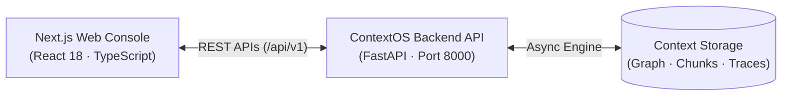

# ContextOS Web Console (`contextos-web`)

> **Minimalist Enterprise Frontend Console for ContextOS**  
> Built with Next.js 14, React 18, TypeScript, and Tailwind CSS. Designed with an Atlan-inspired minimalist aesthetic (neutral grays, crisp borders, subtle status indicators, zero neon glassmorphism).

---

## Table of Contents

1. [Executive Summary](#1-executive-summary)
2. [Design Philosophy & UI Standards](#2-design-philosophy--ui-standards)
3. [Core Architecture & Technology Stack](#3-core-architecture--technology-stack)
4. [Repository Structure](#4-repository-structure)
5. [Getting Started & Local Setup](#5-getting-started--local-setup)
6. [Environment Configuration](#6-environment-configuration)
7. [Console Layout & Navigation](#7-console-layout--navigation)
8. [Screen 1: Executive Overview (`/`)](#8-screen-1-executive-overview-)
9. [Screen 2: Enterprise Data Sources (`/sources`)](#9-screen-2-enterprise-data-sources-sources)
10. [Screen 3: Metadata Catalog (`/catalog`)](#10-screen-3-metadata-catalog-catalog)
11. [Screen 4: Data Lineage Explorer (`/lineage`)](#11-screen-4-data-lineage-explorer-lineage)
12. [Screen 5: Context Graph Topology (`/graph`)](#12-screen-5-context-graph-topology-graph)
13. [Screen 6: Context Agents Registry (`/agents`)](#13-screen-6-context-agents-registry-agents)
14. [Screen 7: Governance & Approval Queue (`/governance`)](#14-screen-7-governance--approval-queue-governance)
15. [Screen 8: Agent Access & MCP Protocol (`/agent-access`)](#15-screen-8-agent-access--mcp-protocol-agent-access)
16. [Screen 9: Observability & Trace Waterfall (`/observability`)](#16-screen-9-observability--trace-waterfall-observability)
17. [Screen 10: Evaluation Benchmarks (`/evaluations`)](#17-screen-10-evaluation-benchmarks-evaluations)
18. [API Client & Communication Architecture](#18-api-client--communication-architecture)
19. [Security, Performance & Type Safety](#19-security-performance--type-safety)
20. [Production Deployment & Roadmap](#20-production-deployment--roadmap)

---

## 1. Executive Summary

The **ContextOS Web Console** is the administrative and engineering control plane for ContextOS. It allows enterprise data engineers, governance stewards, and AI architects to inspect, verify, and govern the enterprise context consumed by autonomous AI agents.

Rather than treating context as an opaque black box of embedding vectors, the console provides full visibility into:
- The multi-hop lineage connecting raw tables to executive metrics.
- Discrepancies between contradictory business definitions.
- Human-in-the-loop approval queues for sensitive metric corrections.
- Model Context Protocol (MCP) server configurations.
- Real-time distributed trace spans and cost accounting.

---

## 2. Design Philosophy & UI Standards

The console is inspired by modern enterprise data platforms such as **Atlan**:
- **Palette**: Clean slate/zinc grays (`slate-900`, `slate-700`, `slate-500`, `slate-200`, `slate-50`), crisp white card containers, and subtle border lines (`border-slate-200`).
- **Accent Signals**: Functional color accents only (Emerald for certified/healthy, Amber for pending review/disputed, Sky for active sync, Rose for failures/rejections).
- **Typography**: Clean tabular layout with font-mono accents for IDs, hashes, SQL types, and trace IDs.
- **Zero Distractions**: No exaggerated neon glows, glassmorphism blur filters, or oversized hero sections. Dense, high-information-density enterprise tooling.

---

## 3. Core Architecture & Technology Stack

- **Framework**: Next.js 14 (App Router)
- **UI Runtime**: React 18
- **Language**: TypeScript 5 (Strict Mode)
- **Styling**: Tailwind CSS with custom typography utilities
- **Icons**: Lucide React
- **Client Architecture**: Pure decoupled client communicating with `contextos-api` exclusively over documented HTTP JSON REST endpoints. Zero duplicated backend business logic.



---

## 4. Repository Structure

```
contextos-web/
├── public/                             # Static public assets
├── src/
│   ├── app/                            # Next.js 14 App Router Screens
│   │   ├── layout.tsx                  # Root shell with global sidebar & header
│   │   ├── page.tsx                    # Screen 1: Executive Overview & Live Context Query
│   │   ├── sources/page.tsx            # Screen 2: Enterprise Data Sources, Cursors & DLQ
│   │   ├── catalog/page.tsx            # Screen 3: Metadata Catalog & Schema Inspector
│   │   ├── lineage/page.tsx            # Screen 4: Data Lineage Multi-Hop Explorer
│   │   ├── graph/page.tsx              # Screen 5: Context Graph Topology & Stats
│   │   ├── agents/page.tsx             # Screen 6: Context Agents Registry & Run History
│   │   ├── governance/page.tsx         # Screen 7: Human Approval Queue & Decision Dialog
│   │   ├── agent-access/page.tsx       # Screen 8: MCP Protocol Endpoints & Tool Catalog
│   │   ├── observability/page.tsx      # Screen 9: Distributed Traces & Span Waterfall
│   │   ├── evaluations/page.tsx        # Screen 10: Golden Regression Benchmark Runner
│   │   └── globals.css                 # Global CSS and Tailwind directives
│   │
│   ├── components/                     # Reusable Console Components
│   │   ├── layout/
│   │   │   ├── SidebarNav.tsx          # 10-item primary enterprise navigation
│   │   │   └── AppHeader.tsx           # Global header with environment badges
│   │   └── ui/                         # Atomic UI building blocks
│   │
│   └── lib/                            # Client Utilities & Typed API Layer
│       ├── api/
│       │   └── client.ts               # Fully-typed fetch client for ContextOS REST API
│       └── types/
│           └── api.ts                  # Shared TypeScript interfaces & domain enums
│
├── package.json                        # Locked dependencies (React 18.3, Next 14.2)
├── tailwind.config.ts                  # Custom Tailwind tokens and color palette
├── tsconfig.json                       # TypeScript compiler configuration
├── next.config.mjs                     # Next.js build and optimization options
└── README.md                           # Documentation
```

---

## 5. Getting Started & Local Setup

### Prerequisites

- Node.js 18+ or 20+ (Node v25 verified)
- Running instance of `contextos-api` on port `8000`

### Installation & Execution

```bash
# 1. Navigate to the web directory
cd contextos-web

# 2. Install dependencies
npm install

# 3. Create local environment configuration
cp .env.example .env.local

# 4. Start the development server
npm run dev
```

Open `http://localhost:3000` in your browser.

### Production Build Verification

```bash
npm run build
```
*Generates optimized static pages for all 13 application routes with zero type errors.*

---

## 6. Environment Configuration

Create a `.env.local` file in the `contextos-web` root:

```env
# URL pointing to the ContextOS FastAPI backend
NEXT_PUBLIC_API_URL=http://localhost:8000/api/v1
```

---

## 7. Console Layout & Navigation

The console shell consists of:
- **Left Navigation Rail (`SidebarNav.tsx`)**: 10 primary navigation destinations with active route highlighting, icon accents, and environment indicators.
- **Top Bar (`AppHeader.tsx`)**: System health status pill, database connectivity indicator, and global search shortcut.
- **Main Viewport**: High-density responsive workspace designed for complex data inspection.

---

## 8. Screen 1: Executive Overview (`/`)

The Overview dashboard surfaces real-time enterprise metrics and provides an interactive **Traceable Context Query** simulator:
- **KPI Metrics**: Total Enterprise Assets, Verified Lineage Edges, Active Agents, and Open Discrepancy Alerts.
- **Interactive Context Query Simulator**: Input any natural language business prompt (e.g., *"Why does our monthly revenue dashboard show a different number from the finance report?"*).
- **Grounded Results View**: Displays matched entities with relevance scores, cryptographic provenance extraction methods, and active definition conflict alerts with confidence scores.

---

## 9. Screen 2: Enterprise Data Sources (`/sources`)

Provides management and monitoring for all connected enterprise systems:
- **Mechanism Architecture Banners**: Visual status cards for Mechanism A (Background Sync), Mechanism B (On-Demand MCP), and Mechanism C (Live Fallback).
- **Connected Systems**: Lists PostgreSQL, Snowflake, dbt, Notion, GitHub, and Slack sources with:
  - Source type and authentication badges (`API_TOKEN`, `OAUTH2`).
  - Freshness SLA threshold (e.g. 900 seconds).
  - OAuth granted scope pills.
  - One-click **Sync Now** trigger with spinning activity indicator.
- **Dead-Letter Queue (DLQ) Inspector**: Inspects quarantined records that failed schema validation or parsing after maximum exponential backoff retries, showing retry counts, error reasons, and raw payloads.

---

## 10. Screen 3: Metadata Catalog (`/catalog`)

A discovery engine for enterprise data assets:
- **Search & Filter Bar**: Filter by keyword across names, qualified identifiers, descriptions, and asset types (`TABLE`, `TRANSFORMATION_MODEL`, `DASHBOARD`, `METRIC`, `DOCUMENTATION`, `SLACK_CHANNEL`, `GITHUB_PR`).
- **Two-Column Master-Detail Inspector**:
  - Left: Scrollable asset list with certification badges (`CERTIFIED`, `PENDING_REVIEW`, `DISPUTED`).
  - Right: Detailed inspector displaying semantic description, verified human owner, cryptographic provenance anchor, and full column schema table (`[PK]`, data types, nullability).

---

## 11. Screen 4: Data Lineage Explorer (`/lineage`)

An interactive multi-hop dependency visualizer:
- **Root Anchor Selector**: Choose any asset in the catalog as the focus node.
- **Multi-Hop Progression Flow**: Visualizes end-to-end lineage from raw ingested tables $\to$ dbt transformation models $\to$ certified metrics $\to$ downstream BI dashboards.
- **Verified Dependency Edges**: Table detailing relationship types (`DERIVED_FROM`, `DEFINES_METRIC`, `FEEDS_DASHBOARD`) and algorithmic edge confidence percentages.

---

## 12. Screen 5: Context Graph Topology (`/graph`)

Visualizes the global enterprise context graph:
- High-level topology breakdown showing node counts by asset type and edge counts by relationship type.
- Entity density metrics and isolated node indicators.
- Raw graph JSON inspector for programmatic integration.

---

## 13. Screen 6: Context Agents Registry (`/agents`)

Registry of autonomous agents with access to ContextOS:
- Displays registered agents, operational roles, and assigned tool permission lists (`search_context`, `get_lineage`, `request_metric_correction`).
- Run history tab showing execution duration, token consumption, and status (`COMPLETED`, `WAITING_APPROVAL`, `FAILED`).

---

## 14. Screen 7: Governance & Approval Queue (`/governance`)

The Human-in-the-Loop (HITL) control plane:
- Displays pending approval requests triggered by AI agents attempting sensitive operational changes.
- Shows proposed value, agent reasoning, model confidence score, and affected asset.
- **One-Click Actions**: **Approve** and **Reject** buttons that communicate directly with `/api/v1/approvals/{id}/decide`.

---

## 15. Screen 8: Agent Access & MCP Protocol (`/agent-access`)

Developer portal for connecting external AI agent runtimes:
- Documents the standard **Model Context Protocol (MCP)** JSON-RPC 2.0 interface.
- Complete documentation of all 7 exposed MCP tools (`search_context`, `search_assets`, `get_asset_details`, `get_lineage`, `get_business_definition`, `get_asset_owner`, `retrieve_source_evidence`).
- Copy-paste ready configuration snippet for `claude_desktop_config.json`.

---

## 16. Screen 9: Observability & Trace Waterfall (`/observability`)

Telemetry dashboard for AI operations:
- Filter traces by Agent Run ID or execution status.
- **Span Waterfall Visualizer**: Step-by-step breakdown of execution time spent in `USER_REQUEST`, `CONTEXT_RETRIEVAL`, `TOOL_EXECUTION`, and `APPROVAL_GATE`.
- Detailed span inspector displaying redacted input arguments and output results.

---

## 17. Screen 10: Evaluation Benchmarks (`/evaluations`)

Continuous regression testing console:
- Tracks historical runs of the Golden Benchmark dataset.
- Visual cards displaying **Recall@K**, **Entity Resolution Accuracy**, **Context Relevance**, and **Policy Compliance Rate**.
- **Run Evaluation Benchmark** button that executes the test suite against the backend and updates metrics in real time.

---

## 18. API Client & Communication Architecture

Communication with the backend is centralized in `src/lib/api/client.ts`:
- Uses the standard browser `fetch` API configured with `cache: "no-store"` to ensure up-to-date data.
- Automatically handles JSON deserialization and maps HTTP error status codes into human-readable console warnings.
- Fully typed using TypeScript definitions in `src/lib/types/api.ts`.

---

## 19. Security, Performance & Type Safety

1. **Strict TypeScript Typing**: No `any` escape hatches in domain types.
2. **Zero Client Secret Leaks**: All enterprise source secrets reside strictly on the backend; the frontend receives only non-sensitive configuration metadata and scope lists.
3. **Payload Sanitization**: User queries and search terms are URI-encoded before network transmission.
4. **Optimized Bundle Size**: First Load JS is $< 94\text{ kB}$ across all routes.

---

## 20. Production Deployment & Roadmap

### Production Deployment (Vercel / Docker)

```bash
# Build the production bundle
npm run build

# Start the Node.js production server
npm run start -p 3000
```

### Roadmap
- [x] 10 core navigation views with Atlan-inspired minimalist design
- [x] Traceable context query simulator with discrepancy alerts
- [x] Human approval queue with live decision triggers
- [x] Dead-Letter Queue inspection and source sync controls
- [ ] Interactive React Flow drag-and-drop graph layout
- [ ] Dark mode toggle support
- [ ] Real-time WebSocket connection for live trace streaming
